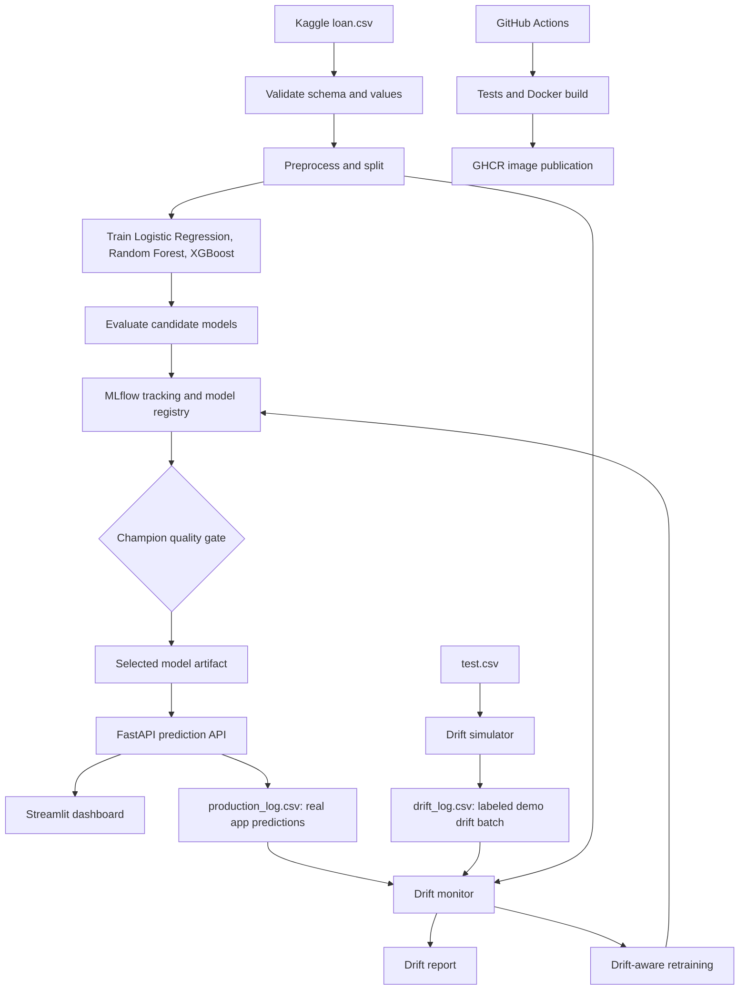

<div align="center">

# LoanLens

### Loan approval prediction with a reproducible, monitored MLOps lifecycle

[](https://github.com/KAVINGUPTA09/loanops/actions/workflows/ci.yml)
[](https://github.com/KAVINGUPTA09/loanops/actions/workflows/cd.yml)


**A local-first academic project demonstrating data validation, model comparison, model serving, monitoring, retraining, and CI/CD.**

[Project overview](#1-project-overview) ·
[Architecture](#2-system-architecture) ·
[How it works](#3-end-to-end-working) ·
[Components](#4-component-by-component-guide) ·
[Run the project](#10-run-the-project)

</div>

---

## 1. Project overview

LoanLens predicts a loan application's approval probability from applicant,
loan, and credit-history features. It combines a machine-learning pipeline with
a REST API and a browser dashboard, then demonstrates how a model can be
tracked, monitored, retrained, and packaged.

The project compares three classifiers:

1. **Logistic Regression** — a simple, interpretable baseline.
2. **Random Forest** — an ensemble of decision trees that can learn
   non-linear patterns.
3. **XGBoost** — a gradient-boosted tree model.

They are trained and evaluated using the same split within a training run.
Candidate selection uses ROC-AUC, with F1 as the tie-breaker. The active model
is selected through an MLflow `champion` alias and a quality gate.

The API returns both a probability and a decision. The decision threshold is
configurable in `params.yaml`:

```text
probability >= 0.65  -> Approved
probability < 0.65   -> Rejected
```

This is an academic demonstration, **not a real lending decision service**.
Its model and data are not validated or approved for banking use.

## 2. System architecture



### Technologies and their roles

| Technology | Role in LoanLens |
|---|---|
| Python, Pandas | Application code and tabular data processing |
| scikit-learn | Preprocessing, Logistic Regression, Random Forest, and metrics |
| XGBoost | Gradient-boosted tree candidate |
| DVC | Reproducible ML pipeline and data/output dependency tracking |
| MLflow | Experiment runs, metrics, artifacts, model versions, champion alias |
| FastAPI, Pydantic | Validated REST API and model serving |
| Streamlit | Interactive prediction and monitoring dashboard |
| SHAP | Feature-contribution explanations |
| SciPy, Evidently | Statistical drift checks and HTML monitoring report |
| Pytest, Flake8 | Automated tests and style checks |
| Docker, GHCR | Container packaging and image registry |
| GitHub Actions | Automated CI, image publishing, and drift workflow |

## 3. End-to-end working

### 3.1 Dataset and validation

The project dataset is the 614-row loan CSV from
[Kaggle — Loan CSV](https://www.kaggle.com/datasets/tanishaj225/loancsv?resource=download).
The repository's raw dataset is `data/loan.csv`; its DVC pointer is
`data/loan.csv.dvc`.

The expected fields are:

```text
Loan_ID, Gender, Married, Dependents, Education, Self_Employed,
ApplicantIncome, CoapplicantIncome, LoanAmount, Loan_Amount_Term,
Credit_History, Property_Area, Loan_Status
```

`Loan_Status` is the target: `Y` denotes approval and `N` denotes rejection.
The validator checks required fields, minimum row count, numeric ranges, and
allowed target values. The dataset includes missing values; preprocessing
handles them as part of the fitted model pipeline.

Check Kaggle's current license and dataset terms before redistribution or
commercial use. The data is for this academic demonstration, not production
credit decisions.

### 3.2 Preprocessing

Preprocessing converts the target to `1/0`, maps `Dependents=3+` to `3`, then
creates a stratified training and test split. The current checked-in dataset
produces 491 training rows and 123 test rows with the configured seed.

The saved scikit-learn pipeline keeps preprocessing with the estimator:

- Numeric features: median imputation and standard scaling.
- Categorical features: most-frequent imputation and one-hot encoding.
- Unknown categorical values are ignored by the encoder rather than causing
  serving-time failures.

Keeping these steps in one pipeline helps prevent training-serving skew.

### 3.3 Training and candidate selection

`src/train.py` fits Logistic Regression, Random Forest, and XGBoost. For each
model it records an MLflow run with parameters, metrics, data hash, and
evaluation plots.

Metrics include:

- **Accuracy:** fraction of all predictions that are correct.
- **Precision:** fraction of predicted approvals that are actual approvals.
- **Recall:** fraction of actual approvals that the model identifies.
- **F1:** harmonic mean of precision and recall.
- **ROC-AUC:** ranking/discrimination performance across classification
  thresholds.

The model with the highest ROC-AUC is the candidate; F1 breaks a tie. Model
complexity alone does not determine the winner: a linear model can outperform
tree models on a particular dataset and split.

### 3.4 MLflow registry and champion

MLflow is configured locally:

```text
mlflow.db  -> run and registry metadata (SQLite)
mlruns/    -> run artifacts
loan_model -> registered model
champion   -> alias for the active approved model
```

Every selected candidate is registered as a new model version. Registering a
version does **not** make it the champion. The candidate and incumbent
champion are scored on the same evaluation split for a run. The alias moves
only when the candidate meets the configured ROC-AUC improvement in
`params.yaml`; otherwise, the existing champion remains active.

Different training runs may use different evaluation splits (for example,
baseline versus drift-augmented data). Their historical ROC-AUC tags should
not be compared as if they were measured on identical data. For a promotion
decision, compare the candidate and incumbent evaluated on the same holdout.

The dashboard's **Promote latest candidate (demo)** action is a demonstration
shortcut that bypasses the quality gate. It is not the normal promotion path.

### 3.5 API and dashboard

FastAPI loads the selected local model artifact at startup. Its endpoints are:

| Endpoint | Purpose |
|---|---|
| `GET /health` | API readiness and selected model metadata |
| `GET /model-info` | Active model, metrics, registry version, and decision |
| `POST /predict` | Validates input and returns prediction, probability, and SHAP reasons |

The Streamlit dashboard calls FastAPI; it does not independently score the
application. The dashboard includes an applicant form, prediction history,
model comparison, model details, and drift/retraining controls.

### 3.6 Prediction history and drift data

These two CSVs serve different purposes:

| File | Contents | How it is written |
|---|---|---|
| `data/production_log.csv` | Inputs and outputs from successful API predictions | API appends one row per prediction |
| `data/drift_log.csv` | Intentionally shifted, labeled demo batch | Drift simulator creates/replaces it from `data/test.csv` |

The simulator changes selected feature distributions, such as loan amount,
loan term, credit history, education, and property area. It keeps the held-out
Kaggle `Loan_Status` labels for the academic retraining demo. Simulation does
not overwrite the normal API prediction history.

The drift monitor compares `data/train.csv` (reference) against
`data/drift_log.csv` when that file exists; otherwise it falls back to
`data/production_log.csv`. Numeric columns are tested with the
Kolmogorov-Smirnov test and categorical columns with the chi-square test.
`drift.threshold` controls the drifted-feature share needed to trigger.
Evidently creates `reports/drift_report.html`; a SciPy-based report is used if
Evidently report generation is unavailable.

### 3.7 Drift-aware retraining

Retraining requires a drift batch with a `Loan_Status` target. It merges a
weighted sample of that labeled batch with the original training baseline,
creates a new stratified train/evaluation split, and trains/evaluates the
three candidates on that data. Temporary retraining splits are separate files;
the original DVC baseline split is not overwritten.

The retraining path then updates evaluation, SHAP, and fairness outputs and
registers a candidate in MLflow. The quality gate decides whether it becomes
the champion. A candidate may be registered while the existing champion is
retained.

**Production caveat:** live predictions do not immediately have verified
outcome labels. A real production retraining loop must wait for confirmed
loan outcomes. It must not treat a model's own predictions as ground truth.
The current labeled drift simulator is a controlled demonstration, not a
real-world feedback system.

### 3.8 Fairness and explainability

SHAP estimates feature contributions to model output and is used to produce
global reports and per-prediction reasons. Fairness reporting compares
approval rate and recall across Gender and Married groups.

These are diagnostic tools. SHAP is not a causal explanation, and the group
metrics do not constitute a legal fairness certification.

### 3.9 DVC, Docker, and CI/CD

`dvc.yaml` defines this reproducible pipeline:

```text
validate -> preprocess -> train -> evaluate -> explain -> fairness
```

`dvc repro` checks dependencies and runs stages whose inputs or outputs are
stale. `dvc repro -f` forces every stage. DVC does not start MLflow, FastAPI,
or Streamlit. `dvc.lock` records the pipeline state; `dvc push` sends DVC
objects to the configured remote.

Docker packages the application and its runtime dependencies. GitHub Actions:

- **CI:** installs dependencies, runs DVC, lint, tests, and a Docker build.
- **CD:** builds and publishes the image to GitHub Container Registry (GHCR).
- **Drift check:** runs manually or on schedule and uploads the report.

GHCR image names:

```text
ghcr.io/kavingupta09/loanops:latest
ghcr.io/kavingupta09/loanops:<commit-sha>
```

Publishing an image is not the same as deploying it. AWS ECR/ECS is not
configured. CD can trigger a Render deployment only if the corresponding
deploy-hook secret is configured.

## 4. Component-by-component guide

| Path | Responsibility |
|---|---|
| `app/main.py` | FastAPI app, request validation, model loading, prediction, SHAP reasons, prediction logging |
| `frontend/streamlit_app.py` | Dashboard, API calls, history, model comparison, drift/retraining buttons |
| `src/validate_data.py` | Dataset schema, target, row-count, and range checks |
| `src/preprocess.py` | Target conversion, feature normalization, train/test split |
| `src/train.py` | Preprocessing/model pipelines, three estimators, metrics, MLflow registration and champion gate |
| `src/evaluate.py` | Confusion matrix, ROC curve, and metrics output |
| `src/explain.py` | SHAP summary report |
| `src/fairness.py` | Approval-rate and recall summaries by group |
| `src/drift.py` | Statistical drift tests and HTML report |
| `src/retrain.py` | Labeled drift-batch preparation, retraining split, and lifecycle rerun |
| `src/utils.py` | Central parameter loading, paths, hashing, and JSON helpers |
| `scripts/simulate_drift.py` | Creates the separate drift-demo batch |
| `scripts/promote_latest_candidate.py` | Demonstration-only manual candidate promotion |
| `scripts/smoke_test.py` | End-to-end local smoke workflow |
| `tests/` | API, data, and model-focused tests |
| `data/` | Raw, split, production-log, and demo drift CSVs |
| `models/` | Selected serialized pipeline and model metadata |
| `reports/` | Evaluation, fairness, SHAP, and drift outputs |
| `docs/` | Architecture, project report, presentation, self-audit, and viva material |
| `.github/workflows/` | CI, CD, and scheduled/manual drift check workflows |
| `params.yaml` | Pipeline paths, model parameters, thresholds, and split settings |
| `dvc.yaml`, `dvc.lock` | Pipeline stages and last reproduced dependency state |
| `Dockerfile`, `docker-compose.yml` | Container image and local service orchestration |

## 5. Configuration

Key options in `params.yaml`:

| Setting | Meaning |
|---|---|
| `random_state` | Reproducibility seed |
| `paths.*` | Dataset, model, and report paths |
| `training.test_size` | Test split proportion |
| `training.min_improvement` | Minimum ROC-AUC gain required for promotion |
| `training.approval_threshold` | Classification threshold; currently `0.65` |
| `training.drift_weight` | Fraction of the drift batch added during retraining |
| `training.models.*` | Estimator hyperparameters |
| `drift.threshold` | Drifted-feature share needed to trigger |
| `drift.min_rows` | Minimum current-batch size for monitoring |

## 6. Repository layout

```text
loanops/
├── app/
├── frontend/
├── src/
├── scripts/
├── tests/
├── data/
├── models/
├── reports/
├── docs/
├── .github/workflows/
├── dvc.yaml
├── dvc.lock
├── params.yaml
├── requirements.txt
├── Dockerfile
├── docker-compose.yml
└── README.md
```

## 7. Validation and tests

Run the test suite:

```powershell
python -m pytest -q
```

Lint project Python code:

```powershell
python -m flake8 src app scripts tests frontend
```

Compile-check Python source:

```powershell
python -m compileall -q src app scripts tests frontend
```

The tests cover API health/input validation, dataset checks, retraining label
handling, and model pipeline behavior. The smoke script exercises local
pipeline/API/drift/retraining stages and may create local artifacts.

## 8. Limitations and responsible use

- The Kaggle dataset is small and intended for an academic demonstration.
- It is not representative evidence of real lending performance.
- There is no live, verified applicant-outcome feedback loop.
- Drift data is intentionally simulated for demonstration.
- MLflow and the SQLite registry are local, not highly available cloud services.
- Prediction history is stored in a local CSV.
- Authentication, authorization, rate limiting, and durable audit storage are
  not implemented.
- Fairness summaries require domain and legal review.
- GHCR image publication is configured; AWS deployment is not.

Do not use the project to make real loan decisions. A production system would
require approved data, licensing review, privacy/security controls, validated
outcomes, independent model validation, human oversight, fairness review,
monitoring, rollback, and regulatory compliance.

## 9. Documentation

- [Project report](docs/PROJECT_REPORT.md)
- [Presentation outline](docs/PRESENTATION_OUTLINE.md)
- [Viva preparation](docs/VIVA_PREP.md)
- [Self-audit and troubleshooting](docs/SELF_AUDIT.md)
- [Architecture diagram](docs/architecture.mmd)

---

## 10. Run the project

The following is the **local Windows PowerShell** workflow. Run commands from
the repository root. Start the long-running services in separate terminals
and leave each service terminal open.

### 10.1 Prerequisites

- Python 3.11 recommended (CI uses 3.11; local Python 3.12 is supported)
- Git
- Docker Desktop only if running/building containers locally

### 10.2 Clone or open the repository

To clone:

```powershell
cd "F:\"
git clone https://github.com/KAVINGUPTA09/loanops.git
cd loanops
```

Or open the existing checkout:

```powershell
cd "F:\mse2 genai"
```

### 10.3 Create and activate the environment

```powershell
py -3.11 -m venv .venv
Set-ExecutionPolicy -Scope Process -ExecutionPolicy RemoteSigned
.\.venv\Scripts\Activate.ps1
python -m pip install --upgrade pip
pip install -r requirements.txt
```

If using Python 3.12, substitute `py -3.12` when creating the venv.

### 10.4 Ensure the Kaggle CSV is present

The required file is `data/loan.csv`. Download it from
[Kaggle — Loan CSV](https://www.kaggle.com/datasets/tanishaj225/loancsv?resource=download)
and place the CSV at that path if it is not already present. Check Kaggle's
license/terms before redistribution.

Validate the file:

```powershell
python -m src.validate_data
```

### 10.5 Run the DVC pipeline

One-time/local remote setup (safe to repeat):

```powershell
python scripts\setup_dvc.py
```

Normal incremental run:

```powershell
dvc repro
```

Force every stage to rerun only when deliberately needed:

```powershell
dvc repro -f
```

The pipeline should complete before starting servers, especially because the
training stage writes MLflow and model artifacts.

### 10.6 Start MLflow — Terminal 2

Open another PowerShell terminal:

```powershell
cd "F:\mse2 genai"
.\.venv\Scripts\Activate.ps1
mlflow ui --backend-store-uri sqlite:///mlflow.db --host 127.0.0.1 --port 5000
```

Open [http://127.0.0.1:5000](http://127.0.0.1:5000). Inspect runs, metrics,
registered model `loan_model`, versions, and the `champion` alias. Keep the
terminal running.

### 10.7 Start FastAPI — Terminal 3

```powershell
cd "F:\mse2 genai"
.\.venv\Scripts\Activate.ps1
uvicorn app.main:app --reload
```

Open [http://127.0.0.1:8000/docs](http://127.0.0.1:8000/docs). Check `GET
/health` and `GET /model-info`. Use Swagger's `POST /predict` to send a
prediction. Keep this terminal running.

Example request:

```json
{
  "Gender": "Male",
  "Married": "Yes",
  "Dependents": "0",
  "Education": "Graduate",
  "Self_Employed": "No",
  "ApplicantIncome": 5000,
  "CoapplicantIncome": 2000,
  "LoanAmount": 150,
  "Loan_Amount_Term": 360,
  "Credit_History": 1,
  "Property_Area": "Urban"
}
```

### 10.8 Start Streamlit — Terminal 4

```powershell
cd "F:\mse2 genai"
.\.venv\Scripts\Activate.ps1
streamlit run frontend\streamlit_app.py
```

Open [http://127.0.0.1:8501](http://127.0.0.1:8501). Submit applicant
details, inspect the decision/probability/reasons, compare the three models,
and view the active champion. Keep the API, MLflow, and Streamlit terminals
running concurrently.

### 10.9 Inspect logs and run drift demo

Normal API predictions append to `data/production_log.csv`:

```powershell
Import-Csv .\data\production_log.csv | Select-Object -Last 5
```

In the Streamlit sidebar select **Simulate drift**, then **Check for drift**.
Equivalent commands:

```powershell
python scripts\simulate_drift.py
python -m src.drift
```

The simulator creates `data/drift_log.csv` separately; it does not overwrite
the API prediction log. Drift compares the training baseline with the drift
batch (or falls back to the production log when no drift batch exists). The
HTML report is saved as `reports/drift_report.html`.

### 10.10 Retrain and inspect the champion decision

After a drift batch has been created, use Streamlit's **Retrain model** button
or run:

```powershell
python -m src.retrain
```

Then refresh MLflow and inspect the new candidate version and champion alias.
The candidate is promoted only if it meets the configured quality gate;
otherwise the existing champion remains active. Restart FastAPI after an
intentional promotion so it loads the newly selected local model artifact.

### 10.11 Run checks

```powershell
python -m pytest -q
python -m flake8 src app scripts tests frontend
python -m compileall -q src app scripts tests frontend
```

Optional local container:

```powershell
docker compose up --build
```

Stop Compose with:

```powershell
docker compose down
```

### 10.12 GitHub Actions and GHCR

Push a source change to trigger CI and the `main`-branch CD workflow:

```powershell
git status
git add <intended-files>
git commit -m "Describe the change"
git push origin main
```

Or open the repository's **Actions** tab and use **Run workflow** for a
workflow with `workflow_dispatch`. CI validates and builds; CD publishes the
Docker image to GHCR. This does not by itself deploy the application to AWS.

---

<div align="center">

**LoanLens — an academic demonstration of the machine-learning lifecycle, from data to monitoring.**

</div>
